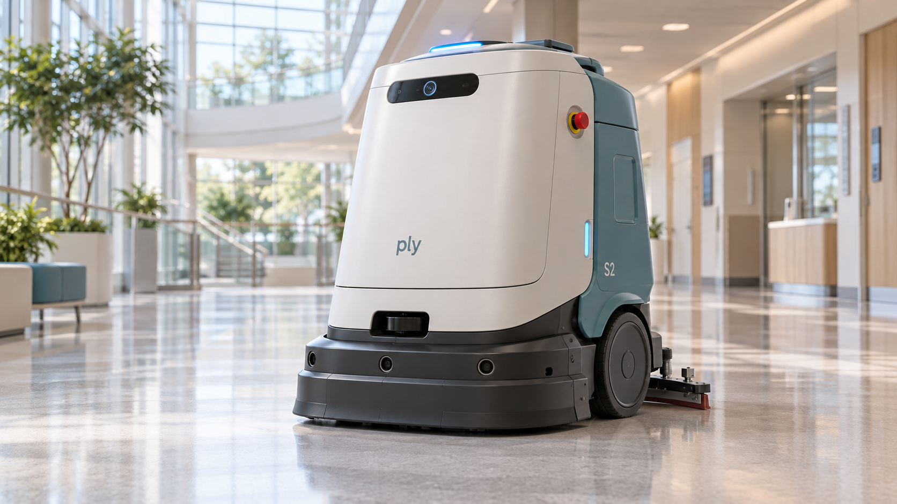
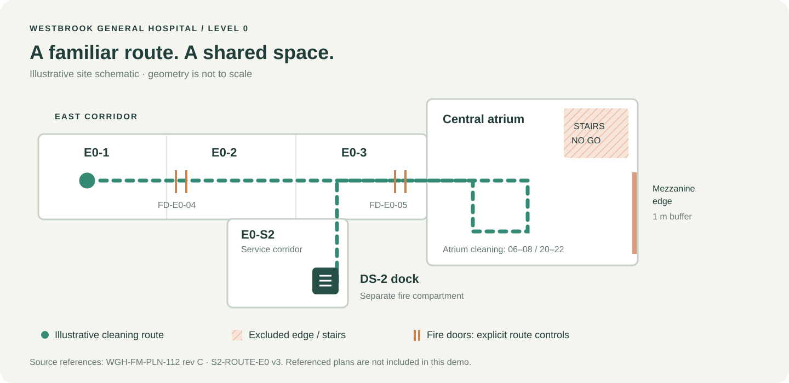

<div align="center">

# Ply Scrub S2

### A cleaner corridor. A clearer view of change.

Hospital variant H · Westbrook General Hospital · RGB camera baseline



*An illustrated engineering mockup for Ply’s GitHub integration demo.*

[Run the simulation](#run-it-in-a-minute) · [Explore the design](docs/architecture.md) · [Camera → LiDAR demo](docs/demo-walkthrough.md) · [Risk assessment](RA-S2-WGH-01.json)

</div>

## Meet S2

S2 is an autonomous floor scrubber built for the busy public corridors of a
hospital. It cleans the east corridor, crosses the central atrium, slows near
people, and returns to its DS-2 dock in the service corridor. When a route becomes
blocked, a remote operator uses its front camera to help it recover.

This repository gives that fictional robot a small, readable software project,
a hardware inventory, and a traceable connection to the supplied Ply risk
assessment. It is designed to make a hardware change feel concrete in a GitHub
pull request.

> **Demo project.** All motion and sensor inputs are simulated. The product image
> is an AI-generated concept. No hardware drivers, real person detection, or
> certified safety functions are implemented. Evidence and approvals in the
> assessment are source records, not results produced by this code.

| Platform | Cleaning | Perception | Operating envelope |
| :--- | :--- | :--- | :--- |
| 180 kg · differential drive | 60 cm cleaning width | Front 1080p RGB camera | Autonomous: **0.8 m/s** |
| 25.2 V · 150 Ah NMC battery | Two 33 cm disc brushes | Separate 2D safety LiDAR | Teleoperation: **0.5 m/s** |
| Units S2-0417 and S2-0418 | 40 L solution + 40 L recovery | Ultrasound, bumper, cliff sensors | Setup: **0.3 m/s** |

Specifications above come from [RA-S2-WGH-01](RA-S2-WGH-01.json). The mockup’s
industrial styling and schematic geometry are illustrative.

## Two sensor paths, two different jobs


**PER-01, the front RGB camera**, feeds the main computer. It supports person
detection for early slowdown and the video view used in remote recovery.
It is not safety-rated.

**PER-02, the existing 2D safety LiDAR**, feeds the safety PLC alongside the bumper,
cliff sensors and emergency stops. It is a separate component with a separate
job. The upcoming demo replaces **PER-01**, leaving PER-02 in place.

## Run it in a minute

The project uses **Python 3.12.14** and only the standard library. No package
installation, API keys, robot middleware, or cloud account are needed.

From the repository root, with Python 3.12 available:

```bash
python3 -m scrub_s2
```

If you use `uv`, `.python-version` selects the pinned interpreter:

```bash
uv run --no-project python -m scrub_s2
```

The interpreter may need to download on the first `uv` run. Subsequent runs are
offline. Each scenario is an independent input/output snapshot.

```text
SCENARIO                 STATE         SPEED    BRUSHES
corridor-cleaning        MOVING      0.8 m/s    200 rpm
person-ahead             SLOWDOWN    0.3 m/s    200 rpm
protective-stop          STOPPED     0.0 m/s      0 rpm
remote-recovery          MOVING      0.5 m/s      0 rpm
video-lag                STOPPED     0.0 m/s      0 rpm
camera-unavailable       STOPPED     0.0 m/s      0 rpm
```

Explore individual cases and their assessment context:

```bash
python3 -m scrub_s2 --list
python3 -m scrub_s2 --scenario person-ahead
python3 -m scrub_s2 --scenario camera-unavailable --json
python3 -m scrub_s2 --trace PER-01
python3 -m scrub_s2 --assessment
```

There are 15 scenarios, including brush-deck lift, bumper contact, cliff
detection, emergency stop, stale video, link loss, setup and docking.

## Built for the GitHub demo

The checked-in design is the **before** state: the RGB camera is still installed
and the simulation still depends on it. The LiDAR replacement is intentionally
left for the live demo.

1. Start with the supplied assessment and this RGB baseline.
2. Open a change replacing the front camera with a navigation LiDAR.
3. Let the integration connect the changed files to components and hazard context.
4. Review the lost camera capabilities, affected evidence and follow-up work in Ply.

The most useful files to change are
[`config/robot.json`](config/robot.json),
[`scrub_s2/perception.py`](scrub_s2/perception.py), and
[`scrub_s2/teleoperation.py`](scrub_s2/teleoperation.py).
Removing the camera affects both person-based slowdown and remote video; a range
scan does not automatically replace either capability.

The original assessment directly links the camera to **HS-01, HS-02 and HS-18**.
These are review candidates, not a precomputed integration result.
See the [demo walkthrough](docs/demo-walkthrough.md) for a ready-to-use change brief,
expected review questions and presenter notes.

## Around the hospital



S2 operates on level 0, from **05:30 to 22:00**, with atrium scrubbing restricted
to **06:00–08:00** and **20:00–22:00**. Stairs, the mezzanine edge and fire doors
need explicit route controls. Wards, operating theatres, lifts and outdoor areas
are excluded. The drawing is a schematic; the real site plan cited in the
assessment is not included.

## What is in the repository?

| Path | Purpose |
| :--- | :--- |
| [`RA-S2-WGH-01.json`](RA-S2-WGH-01.json) | Original Ply export, preserved byte for byte |
| [`config/robot.json`](config/robot.json) | Robot specification and RGB-camera dependencies |
| [`config/site.json`](config/site.json) | Descriptive hospital route and operating limits |
| [`config/traceability.json`](config/traceability.json) | Component UUIDs mapped to implementation files |
| [`hardware/bom.csv`](hardware/bom.csv) | All 25 components from the assessment |
| [`scrub_s2/`](scrub_s2/) | Deterministic perception, motion, interlock and video mockups |
| [`fixtures/scenarios.json`](fixtures/scenarios.json) | 15 scripted operating snapshots |
| [`tests/`](tests/) | Behavior boundaries and assessment traceability checks |
| [`docs/architecture.md`](docs/architecture.md) | Design, ownership and simulation limits |
| [`docs/assessment-map.md`](docs/assessment-map.md) | All 20 hazards and existing open items |
| [`docs/demo-walkthrough.md`](docs/demo-walkthrough.md) | RGB → LiDAR presenter guide |

## Verification

```bash
python3 tools/check.py
```

This runs source syntax and whitespace checks, parses configuration and SVG
files, checks documentation links, and runs the unit tests. The
[GitHub workflow](.github/workflows/checks.yml) uses the pinned Python version and
runs these same checks plus the complete simulation. There is no deployment step.

Passing software tests does not validate robot safety. The supplied assessment
still has **four pending hazard reviews** (HS-05, HS-09, HS-13, HS-19) and a
**pending customer/site release**. Those remain visible in the
[assessment map](docs/assessment-map.md).

---

*Built as a demo world for Ply. Small enough to understand; connected enough to
make a change worth reviewing.*
