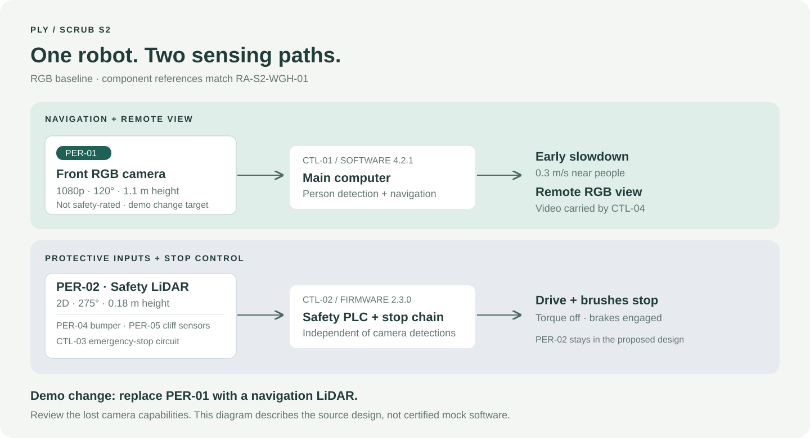

# The S2 design

## Assessment first

[`RA-S2-WGH-01.json`](../RA-S2-WGH-01.json) is the source for component names,
UUIDs, stated specifications, task references and hazard decisions.
[`config/robot.json`](../config/robot.json) extracts the details needed to tell
the demo story. The mockup adds no physical evidence to the assessment.

| Subsystem | Role | Repository representation |
| :--- | :--- | :--- |
| PER | Perception | Camera adapter and protective-input fixtures; ultrasound in inventory |
| DRV | Differential drive and brakes | Requested speed, capped speed and brake state |
| CLN | Brushes, water recovery, dosing | Brush RPM; tank and dosing specifications |
| PWR | Battery, BMS, contacts | Inventory and configuration only |
| CTL | Main computer, safety PLC, e-stops, link | Separate behavior modules; no real controllers |
| HMI | Touchscreen, beacon, speaker | Inventory only; the terminal is a demo readout |
| DCK | DS-2 charging station | Dock-approach speed; charging hardware in inventory |

## One snapshot through the mockup

1. A fixture provides a mode, optional person distance and simulated input signals.
2. `RgbCamera.observe()` produces a nearby-person flag and RGB-video availability.
3. `stop_reasons()` evaluates independent protective inputs, remote heartbeat
   timeout and the setup hold-to-run signal.
4. `view_inhibit_reasons()` checks the remote operator’s video availability and latency.
5. `simulate()` combines those results with the mode speed cap and brush-deck state.
6. The command-line entry point prints a table or JSON. No command leaves the process.

The nearby-person flag is supplied by a fixture, not inferred from pixels.
Person slowdown is 0.3 m/s within 2 m. Protective stops override that slowdown.
Brushes can run at 200 rpm only during simulated autonomous cleaning motion with
the deck lowered. Teleoperation is capped at 0.5 m/s; video older than 300 ms or
a heartbeat age of 500 ms or more inhibits motion in the corresponding snapshot.

## Camera replacement seam

The front camera is **PER-01**, owned by **CTL-01**. Its adapter exports two
distinct capabilities: person detections and RGB video. These are dependencies,
not generic “sensor data.” A replacement adapter must make capability changes
explicit. The baseline rejects unknown sensor types so a one-line configuration
change cannot silently pretend that a LiDAR driver exists.

The existing low-mounted safety scanner is **PER-02**, owned by **CTL-02**.
It remains in the design when PER-01 changes. Nothing in this baseline routes
camera detections into the safety PLC. CTL-04 carries the remote stream; replacing
the sensor does not itself change that wireless hardware.

## Modeling limits

This is a set of independent snapshots, not a time-stepped robot or stateful
safety system. A stop is represented by zero requested speed, engaged brakes
and stopped brushes; no stopping distance or response time is calculated.
Emergency-stop latching, monitored manual reset, actual motor power isolation,
redundancy and diagnostics are not implemented. A following fixture is a new
scenario, not a permitted physical restart.

There is no SLAM, route planner, image recognition, laser processing, networking,
battery charging logic, fire-alarm integration or schedule enforcement. The site
configuration and route drawing are descriptive. The autonomous hold on missing
camera input is an illustrative mockup choice, not a source-validated safeguard.

The source uses safety performance and validation terminology. Those claims
belong to the supplied assessment; the Python modules do not implement or claim
any performance level, safety category or certification.

## Traceability without an invented integration contract

[`config/traceability.json`](../config/traceability.json) associates original
component UUIDs with code or inventory paths. It is ordinary demo data, not a
configuration format required by Ply’s GitHub integration. The integration is
being developed separately and is not implemented here.

[`hardware/bom.csv`](../hardware/bom.csv) is a component inventory, not a purchasing
list. It deliberately contains no invented suppliers, prices or part numbers.
